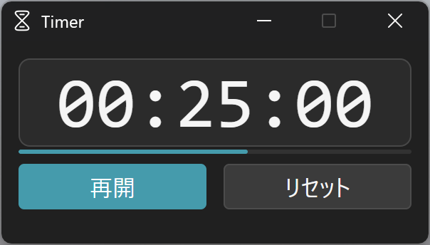

# Timer

Windows / macOS 用のシンプルなカウントダウンタイマーです（Tauri v2）。



## 機能

- 残り時間を大きく表示し、開始・一時停止・再開・リセットができます。
- 時間の表示をクリックすると、時間を編集できます。
  - `HH:MM:SS` 形式か、分だけの数値（例: `25`）で入力します。
  - `↑` / `↓` キーで、カーソルがある位置の時・分・秒を増減できます。
  - `Enter` で確定、`Esc` でキャンセルです。
- 残り時間が 10 分刻み（10分、20分…）と、5分・1分を切ったときに、すべてのモニターに「あと N 分」と表示します。
  - フォーカスを奪わず、クリックも下のウィンドウに通るので、作業の邪魔をしません。
- 時間になると、すべてのモニターに「時間です」と表示します。
  - マウスポインタがあるモニターの表示にフォーカスが移るので、`Enter` / `Esc` でも閉じられます。
  - `timer.wav` があれば、その音をループ再生します。探す場所は、exe と同じフォルダと、設定ファイルと同じフォルダです。
  - macOS では、全画面のアプリの上にも表示します。
- タスクバー（macOS では Dock）のアイコンに、進み具合を表示します。
- OS のライト / ダークテーマとアクセントカラーに合わせて、配色が切り替わります。
- ウィンドウを右クリックして出るメニューから、「常に最前面」を切り替えられます。
- 残り時間、リセットしたときに戻る時間、ウィンドウの位置、最前面の設定を保存します。
  - Windows: `%APPDATA%\rot1024.Timer\settings.json`（WinForms 版と同じ場所・形式なので、そのまま引き継げます）
  - macOS: `~/Library/Application Support/rot1024.Timer/settings.json`
  - 動いている途中で閉じた場合、次に起動したときは一時停止の状態から再開します。
- 表示の言語は、OS が日本語なら日本語、それ以外なら英語になります。

## 開発

Rust（stable）と Node.js が必要です。

```bash
npm install
```

```bash
npm run tauri dev
```

時間の計算と設定ファイルの読み書きは `timer-core` にあり、OS に依存しないので、どこでもテストできます。

```bash
cargo test -p timer-core
```

## ビルド

### Windows 用の exe を WSL からビルドする

```bash
./deploy.sh
```

[cargo-xwin](https://github.com/rust-cross/cargo-xwin) で Windows 用の `timer.exe` をビルドし、Dropbox の `TimerApp.exe` に上書きコピーします。exe 1 つで動きます（Windows 10 / 11 に入っている WebView2 を使います）。初回に要るものは、`deploy.sh` の先頭に書いてあります。

- コピー先は、環境変数 `TIMER_DEST` で変更できます。
- タイマーを起動したままだと上書きできないので、先に閉じてから実行してください。

### Windows / macOS の上でビルドする

```bash
npm run tauri build
```

### リリース

`v*` のタグを push すると、GitHub Actions が Windows のインストーラ（と exe）と macOS（Apple silicon）の `.dmg` をビルドして、下書きのリリースを作ります。署名はしていないので、初回だけ警告が出ます。macOS で「開発元を確認できないため開けません」と出たら、一度だけ次を実行してください。

```bash
xattr -dr com.apple.quarantine /Applications/Timer.app
```

## ファイル構成

| パス | 内容 |
| --- | --- |
| `crates/timer-core/` | 残り時間と状態、「あと N 分」を出すタイミング、設定ファイルの形式（UI と OS に依存しない） |
| `src-tauri/src/lib.rs` | アプリ本体。カウントダウンを回し、ページとやり取りする |
| `src-tauri/src/overlay.rs` | 全部のモニターに出す「あと N 分」「時間です」のウィンドウ（rot1024/hatto と同じ作り） |
| `src-tauri/src/platform/` | OS ごとの処理（音の再生、アクセントカラー、macOS のウィンドウのレベル） |
| `src/index.html` / `main.ts` / `main.css` | メインのウィンドウのページ |
| `src/overlay.html` / `overlay.ts` / `overlay.css` | 全画面の表示のページ |
| `src/time.ts` | 時間の入力の読み取りと、`↑` / `↓` での増減 |
| `deploy.sh` | Windows 用の exe をビルドして Dropbox にコピーするスクリプト |
| `timer.ps1` | PowerShell 版のタイマー（Dropbox の `Timer.lnk` から起動） |
| `docs/screenshot.png` | README のスクリーンショット（Windows 11、ダークテーマ） |
| `timer.svg` / `timer.png` / `timer.ico` | アイコンの元。`src-tauri/icons/` は `npx tauri icon timer.png -o src-tauri/icons` で作ったもの |
